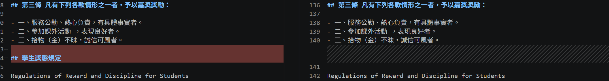
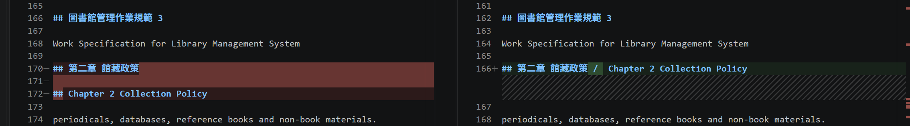
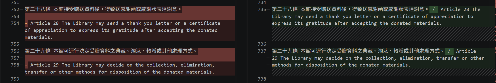
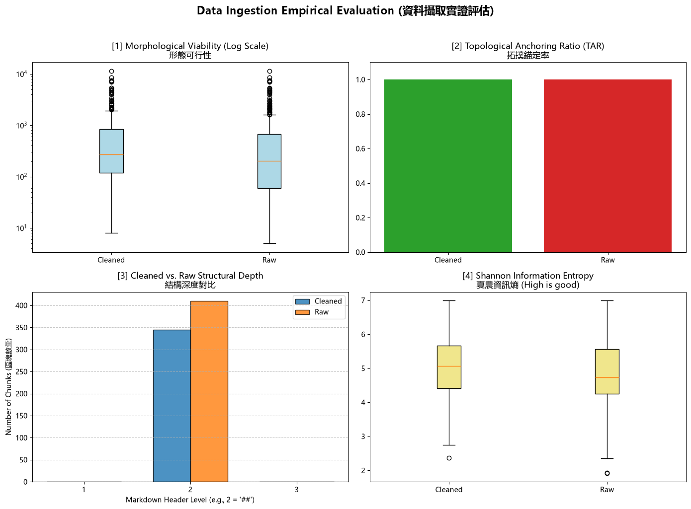

# 資料前處理報告 (Data Preparation Report)

- **學號 / 姓名**：U12627039 / 蔡昇穆
- **專案名稱**：nlp-mcut-qa-system
- **完成的任務**：- [x] 1-A 頁首頁尾清除　- [x] 1-B 雙語標題合併　- [x] 1-C 雙語條文合併

---

## 1. 資料集概覽 (Dataset Overview)

| 類別 (Cluster) | PDF 數量 | 清洗前 chunk 數 | 清洗後 chunk 數 |
|---|---|---|---|
| Academic_Affairs | 3 | 96 | 65 |
| Library_Information | 3 | 248 | 225 |
| Student_Affairs | 3 | 66 | 55 |
| **合計** | **9** | **410** | **345** |

**問題：** 清洗後 chunk 從 410 個減少到 345 個，少了 65 個 (約 15.9%)。chunk 是用 `chunking_regex = r'\n(?=##\s)'` 在每個 `## ` 標題前切開，所以只有「刪掉或合併 `## ` 標題」的任務會改變 chunk 數：我逐步重跑後發現，1-A 刪除了 14 個「`## 法規名稱`」頁首 (410 → 396)，1-B 把中英標題合併成一個，減少 51 個 (396 → 345)。**1-C 不影響 chunk 數量** (345 → 345)，因為它合併的是 `- ` 開頭的清單條文，不會新增或刪除 `## `，切點不變。

## 2. 清洗步驟 (Cleaning Steps)

### 2.1 任務 1-A：頁首頁尾溢出清除

- 檔名：`raw_A242030012_學生獎懲規定.md` / `cleaned_A242030012_學生獎懲規定.md`　搜尋的文字：`## 學生獎懲規定` (清洗前第 154 行)
- 截圖 (存為 `reports/figures/1a_compare.png`)：
- 改變了什麼：第三條的嘉獎清單「三、拾物（金）不昧」與「四、參加校內各項比賽」中間，夾著一行跨頁溢出的頁首 `## 學生獎懲規定`。清洗後這一行被刪除，第三條的清單接回同一段。
- 這對之後的問答檢索有什麼幫助：原本這行 `## ` 會把第三條切成兩個 chunk，後半段 (四～八款) 變成一個標題叫「學生獎懲規定」、卻沒有條號的 chunk。刪除後第三條完整留在同一個 chunk，問「哪些情形可以記嘉獎」時能一次找到全部款項。
- 這個任務有沒有**改錯**的地方：**有**。`cleaned_A242060013_學生請假作業辦法.md`，搜尋 `Guidelines of Leave Application for Students`：清洗前第 86 行的 `## 學生請假作業辦法` 是內文開頭真正的法規標題 (下一行是它的英文標題)，不是頁首，但因為整行只有法規名稱，也被刪掉了，清洗後內文只剩英文標題 `## Guidelines of Leave Application for Students` (第 84 行)。

### 2.2 任務 1-B：雙語標題合併

- 檔名：`raw_A271010023_圖書館管理作業規範.md` / `cleaned_A271010023_圖書館管理作業規範.md`　搜尋的文字：`## 第二章 館藏政策` (清洗前第 170 行)
- 截圖 (存為 `reports/figures/1b_compare.png`)：
- 改變了什麼：`## 第二章 館藏政策` 和下一個標題 `## Chapter 2 Collection Policy` 合併成 `## 第二章 館藏政策 /  Chapter 2 Collection Policy`，英文標題的 `##` 被去掉。
- 這對之後的問答檢索有什麼幫助：合併前，中文標題自己是一個只有標題、沒有內文的 chunk (結構孤兒)；合併後中英標題與底下的內文在同一個 chunk，用中文或英文問「館藏政策」都能找到同一段內容。
- 這個任務有沒有**改錯**的地方：**有**。`cleaned_A232060013_學生抵免學分辦法.md`，搜尋 `Article 4 Principles`：`## Article 4 Principles of Course Waiver and Credit Transfer` 和它底下的小標 `## Principles of course waiver` 都是英文，不是中英對照，卻被合併成一行 (第 170 行)。正則只檢查「第二個標題以英文字母開頭」，沒有檢查「第一個標題是中文」。

### 2.3 任務 1-C：雙語條文合併

- 檔名：`raw_A271010023_圖書館管理作業規範.md` / `cleaned_A271010023_圖書館管理作業規範.md`　搜尋的文字：`第二十八條 本館接受贈送資料後` (清洗前第 752 行)
- 截圖 (存為 `reports/figures/1c_compare.png`)：
- 改變了什麼：第二十八條、第二十九條的中文條文，原本和下面的英文條文 `- Article 28 ...`、`- Article 29 ...` 分開；清洗後各自合併成一行，中間以 ` / ` 連接，英文前面的 `- ` 被去掉。
- 這對之後的問答檢索有什麼幫助：同一條規定的中英文在同一段文字中，檢索到其中一種語言時，另一種語言的對照會一起被帶出來，不會只拿到半條。
- 這個任務有沒有**改錯**的地方：**有**。`cleaned_A242060013_學生請假作業辦法.md`，搜尋 `formula-not-decoded --> /`：第三條的中文在 Docling 轉換時變成了 `<!-- formula-not-decoded -->`，1-C 把英文 `Article 3 Method of Application` 接到這個佔位符後面 (第 100 行)。同一檔案搜尋 `Indigenous ceremonial leave`：英文清單項目被接到英文標題 `## 7. Indigenous ceremonial leave` 後面，整段內文變成標題的一部分 (第 193 行)。原因是第 1 組只要求「非空白的一行」，沒有限制必須是中文。

## 3. 評估指標與 AI 解讀查證 (Metrics & Verifying the AI's Interpretation)

### 3.1 指標數據表

| 指標 | Raw | Cleaned (你的) | Cleaned (參考值) |
|---|---|---|---|
| [1] 中位數長度 Median Length | 205.0 | 272.0 | 272.0 |
| [2] 拓撲錨定率 TAR | 100% | 100% | 100% |
| [3] 深度變異量 SDV (選填) | 0.00 | 0.00 | 0.00 |
| [4] 中位數資訊熵 Entropy (選填) | 4.74 | 5.07 | 5.07 |



一致。我的 Cleaned 結果與參考值 (`metrics.json`) 完全相同：中位數長度 272.0、TAR 100%、SDV 0.00、資訊熵 5.07。

### 3.2 AI 的解讀

- 使用的 AI 工具：Claude (Anthropic)

```text
這張 4 拼圖儀表板比較了清洗前 (Raw) 與清洗後 (Cleaned) 的 chunk 品質：

[1] 形態可行性：Cleaned 的長度中位數從 205 提高到 272 字元，箱型圖整體往上移。
這代表 1-B、1-C 把斷裂的中英標題與條文合併，碎片化的短 chunk 變少了，
每個 chunk 帶有更完整的上下文。兩邊都有長度超過 10,000 字元的離群值，
這些超長 chunk 可能超出 LLM 的上下文視窗，需要再切分。

[2] 拓撲錨定率：Cleaned 與 Raw 都是 100%，代表所有 chunk 都以 ## 標題開頭，
切塊邊界完全對齊文件原本的章節結構，清洗沒有破壞文件結構。

[3] 結構深度：所有 chunk 都是第 2 層標題 (##)，深度變異數為 0，
代表 Docling 把所有標題都輸出成同一層級，沒有辨識出章、條、款的上下階層。
Cleaned 的數量 (345) 比 Raw (410) 少，是標題合併的結果。

[4] 夏農資訊熵：Cleaned 的中位數從 4.74 提高到 5.07，代表清洗後每個 chunk
的字元組成更多樣、資訊更豐富，重複的樣板文字比例下降。最低點 (約 2) 的
chunk 通常是目錄或點線 (.....) 這類重複字元很多的內容。

整體而言，清洗讓 chunk 變得更完整、資訊密度更高，且沒有破壞結構。
```

### 3.3 你的查證 (至少兩點)

**查證 1**
- AI 的說法：「拓撲錨定率 100% 代表切塊邊界完全對齊文件原本的章節結構，清洗沒有破壞文件結構。」
- 我查了什麼：`01_Data_Ingestion.ipynb` 第 5 節的 `chunking_regex = r'\n(?=##\s)'`，以及 `cleaned_A271010023_圖書館管理作業規範.md` 第 162 行開始的 chunk。
- 結論：**錯誤**。切塊規則本身就是「在每個 `## ` 前面切」，所以除了檔案第一段以外，每個 chunk 必定以 `## ` 開頭，TAR 幾乎一定是 100%，無法證明對齊章節結構。反例：`## 圖書館管理作業規範 3` 是跨頁溢出的頁首 + 頁碼 (1-A 只刪「整行只有法規名稱」，帶頁碼的漏掉了)，它被算成「有錨定」的 chunk，但內容只有一行英文頁首 `Work Specification for Library Management System`，並不是任何章節。第 2 節也找到 1-B、1-C 誤併的例子，所以「清洗沒有破壞結構」也不成立。

**查證 2**
- AI 的說法：「長度中位數從 205 提高到 272，是因為 1-B、1-C 把斷裂的標題與條文合併，碎片化的短 chunk 變少了。」
- 我查了什麼：用同一套正則對 9 份 `raw_*.md` 逐步重跑，記錄每一步後的 chunk 數：原始 410 → 1-A 後 396 → 1-B 後 345 → 1-C 後 345 (與 `data/processed/` 的結果一致)。
- 結論：**部分正確**。chunk 變少、平均變長是對的，但原因只有 1-A 和 1-B：它們刪除或合併了 `## ` 切點，讓前後內容併進同一個 chunk。1-C 合併的是 `- ` 清單條文，不改變任何切點，chunk 數完全沒變，對長度中位數幾乎沒有影響 (只少了換行和 `- `)。AI 把 1-C 也列為原因是錯的，而且漏掉了 1-A 的貢獻。

### 3.4 實際證據：你被指定的 chunk

- **SEED**：1106

**(a) 很長的 chunk**
- 資料檔 (JSON)：`data/processed/Student_Affairs/cleaned_A242030012_學生獎懲規定_processed.json`　位置：第 1 個 (從 0 開始數)　長度：4469 字元　驗證碼：`060a91d0`
- 閱讀用檔案 (`.md`)：`data/interim/Student_Affairs/cleaned_A242030012_學生獎懲規定.md`　從第 51 行開始
- 前 3 行內容：
  ```text
  ## 108.12.12 臺教學(二)字第 1080177185 號函備查

  Approved for recordation by Letter Tai-Jao-Xue-(II) No. 1080177185 dated 2019.12.12
  ```
- 這是什麼樣的文字？為什麼會這麼長？這不是規定內文，而是封面的**修訂記錄** (35 行非空白文字中有 29 行是「XX.XX.XX 校務會議修訂 / 臺教學函備查」與對應英文)，後面再接「著作權人」與一整張**目錄表格** (第一條到第十九條的條名與頁碼，中英對照，表格的分隔線 `|-----|` 就有好幾百個字元)。Docling 只把其中一行修訂日期輸出成 `## ` 標題，之後幾十行修訂記錄和目錄都沒有 `## `，切塊規則找不到下一個切點，所以全部擠在同一個 chunk，直到第一條的標題才切開。
- 之後做問答檢索時，這麼長的 chunk 可能造成什麼問題？它的標題是一個日期，內容是修訂記錄加目錄，和學生會問的問題 (例如「什麼情況會記小過」) 幾乎無關，卻因為目錄裡含有所有條名 (小過、大過、銷過…)，可能在檢索時被排到前面，搶走真正條文的名額 (主題稀釋)；送進 LLM 時也會佔掉大量上下文長度，裡面的表格分隔線完全沒有資訊。

**(b) 資訊熵很低的 chunk**
- 資料檔 (JSON)：`data/processed/Library_Information/cleaned_A271010023_圖書館管理作業規範_processed.json`　位置：第 158 個 (從 0 開始數)　資訊熵：3.09　驗證碼：`e39f2dc3`
- 閱讀用檔案 (`.md`)：`data/interim/Library_Information/cleaned_A271010023_圖書館管理作業規範.md`　從第 1717 行開始
- 內容：
  ```text
  ## 總冊數：

  總金額：
  ```
- 為什麼它的資訊熵這麼低？它對問答檢索有用嗎？這是規範附件中**表單**的空白欄位 (「總冊數：」「總金額：」，後面原本是讓人填寫的空格)，整個 chunk 只有 13 個字元。字元數這麼少、又有重複的「總」「：」和 `#`，可能出現的字元種類很少，資訊熵自然很低。Docling 把表單欄位誤判成標題，切出一個只有欄位名稱、沒有內容的 chunk，對問答檢索**沒有用**，反而可能在有人問「總金額」相關問題時被檢索出來，變成雜訊。

## 4. 一個尚未解決的問題 (One Remaining Problem)

- **檔名**：`cleaned_A271010023_圖書館管理作業規範.md`　**從第 162 行開始**　**標題**：`## 圖書館管理作業規範 3`
- **我是怎麼找到的**：做 1-B 截圖時，在比較檢視中看到第二章前面多了一個只有頁首的標題；再用 `Ctrl + F` 搜尋 `圖書館管理作業規範`，發現同一份檔案還有很多「法規名稱 + 頁碼」的行。
- **問題 chunk (貼上部分內容)**：

```text
## 圖書館管理作業規範 3

Work Specification for Library Management System
```

- **問題是什麼**：這是 PDF 每一頁的頁首 (中文法規名稱 + 頁碼，下一行是英文名稱)，不是內容，卻變成一個獨立的 chunk，只有約 60 個字元、沒有任何規定內容。這份檔案清洗後還殘留 15 行「圖書館管理作業規範 + 頁碼」，其中 7 行帶 `## ` 會變成獨立的頁首 chunk；英文頁首 `Work Specification for Library Management System` 也殘留了 14 次。
- **可能的原因**：PDF 頁首本身帶頁碼；Docling 把它當成標題輸出成 `## `；任務 1-A 的清除正則規定「整行只有法規名稱」才刪除，`圖書館管理作業規範 3` 後面多了頁碼，所以沒有被刪；英文頁首完全不在 1-A 的處理範圍內。
- **具體的修正方法**：在 1-A 的動態正則中允許行尾帶頁碼，並同時清除緊接在後的英文頁首，例如：`rf"^[ \t]*(##[ \t]*)?{re.escape(doc_title)}[ \t]*\d*[ \t]*\n+(?:[A-Za-z][^\n]*\n+)?"`。英文頁首也可以用「同一行文字在檔案中重複出現 5 次以上就視為頁首」的規則來刪除。另外可以加一條切塊後的規則：少於 100 字元、且沒有條文內容的 chunk 併入下一個 chunk。
- **對問答檢索的影響**：這些頁首 chunk 沒有實際內容，卻可能因為標題含有「圖書館管理作業規範」而被搜尋排到前面，佔掉檢索結果的名額；頁首也會讓 chunk 數和 TAR 看起來比實際好。

## 5. AI 協作 (AI Collaboration)

- 本次作業的 AI 協作紀錄請見 [`AI_USAGE.md`](AI_USAGE.md) 的「Week 04 / 08」與「Week 09」段落。
- 這次使用 AI 最大的收穫或教訓是：AI 對儀表板的解讀聽起來很合理，但「TAR 100% 代表結構完全對齊」這句是錯的，因為切塊規則本身就保證每個 chunk 以 `##` 開頭。指標要回到程式碼確認它是怎麼算的，才知道數字代表什麼。
